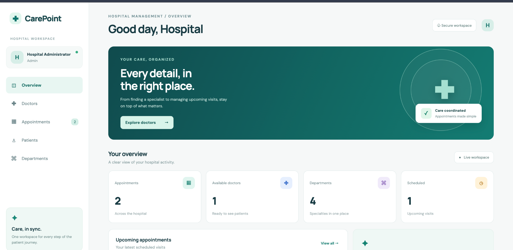

# CarePoint — Hospital Management System

## Project overview

A full-stack hospital-management application built for the Application Development I/II Activity 1 requirements. It combines a Flask REST API, SQLAlchemy data models, Flask-Security-Too token authentication, and a Vue 3 + Axios frontend. The application supports patient registration, doctor discovery, appointment management, department management, and role-protected administration. An optional Celery + Redis worker sends automatic appointment reminders.

## Screenshots

| Sign in | Overview |
|---|---|
|  |  |

| Doctors | Edit a doctor |
|---|---|
|  |  |

| Edit a department | Appointments |
|---|---|
|  |  |

## Features

- Patient registration and token-based login/logout.
- Flask-Security-Too password hashing, access tokens and role-based authorization (`admin`, `doctor`, `patient`).
- SQLAlchemy models and relationships for users, roles, departments, doctors, patients and appointments.
- REST API with JSON responses, validation and meaningful HTTP status codes.
- Full CRUD in both the API and the web UI for departments and doctors (inline edit forms), with optional linked doctor login provisioning;  patient profile editing and admin patient management; appointment create/read/update/cancel.
- Appointment ownership checks: patients only see and manage their own appointments; doctors see their assigned appointments; admins can manage hospital-wide records. Rescheduling validates future dates, doctor availability windows and scheduling conflicts.
- Doctor availability windows (create/list/delete) and treatment records (diagnosis, prescription and notes) linked to appointments, with role and ownership checks.
- Vue 3 single-page interface with Axios token interceptor and responsive layout.
- Environment-based secrets; no hard-coded production signing key or default admin password.
- Optional background jobs: a Celery + Redis worker (with Celery beat) sends appointment reminders to patients before their visit, once per appointment, by email (SMTP) or log output. Admins can also trigger the same job from the UI or API.
- Pytest API tests and GitHub Actions CI.

## Tech stack

- Backend: Python, Flask, Flask-SQLAlchemy / SQLAlchemy, Flask-Security-Too, Flask-CORS
- Frontend: Vue 3, Vite, Axios
- Database: SQLite by default (override with `DATABASE_URL`)
- Testing / CI: Pytest, GitHub Actions
- Optional background jobs: Celery + Redis (appointment reminders)

## Activity requirements coverage

| Requirement | How it is met | Where |
|---|---|---|
| Backend: Flask, SQLAlchemy, Flask-Security | Flask app factory, Flask-SQLAlchemy models, Flask-Security-Too for hashing, roles and token auth | `backend/app.py`, `backend/models.py` |
| Frontend: VueJS, Axios | Vue 3 SPA (Vite) with an Axios instance and token interceptor | `frontend/src/` |
| User authentication | Registration and login endpoints, hashed passwords, logout that invalidates tokens | `/api/auth/*` |
| Token-based authentication | `Authentication-Token` header required on protected routes; missing/invalid token returns JSON `401` | `@auth_required("token")` |
| Role-based access | `admin`, `doctor`, `patient` roles; wrong role returns JSON `403` | `@roles_required`, ownership checks |
| RESTful API | Resource-based URLs, correct verbs and status codes, JSON error format | [API documentation](#api-documentation) |
| CRUD operations | Departments, doctors, patients, appointments, availability windows, treatment records; departments and doctors are fully editable from the UI | [API documentation](#api-documentation) |
| Backend jobs (optional) | Celery worker + beat send appointment reminders; Redis is the broker. Core app runs without them | `backend/celery_app.py`, `backend/reminders.py` |

## Requirements

- Python 3.10 or newer
- Node.js 18 or newer and npm
- Git (optional)

## Installation

Open two terminal windows from the project root.

### 1. Configure and run the backend

```bash
cd backend
python -m venv .venv
# macOS/Linux
source .venv/bin/activate
# Windows PowerShell: .venv\Scripts\Activate.ps1
pip install -r requirements.txt
cp .env.example .env
```

Edit `backend/.env` and set unique random values for `SECRET_KEY` and `SECURITY_PASSWORD_SALT` (at least 32 characters each). Set a strong `ADMIN_PASSWORD` and a suitable `ADMIN_EMAIL`. Do not commit `.env`.

You can generate secrets with:

```bash
python -c "import secrets; print(secrets.token_urlsafe(48))"
```

Start the API:

```bash
python app.py
```

API base URL: `http://127.0.0.1:5000/api`. The database tables, roles and initial admin account are created on first startup. A small set of departments is seeded automatically.

Optional: add sample doctors from the backend directory:

```bash
python seed_demo.py
```

### 2. Run the Vue frontend

In a second terminal:

```bash
cd frontend
npm install
npm run dev
```

Open `http://localhost:5173`. The frontend sends the `Authentication-Token` header automatically after login. If your API runs at a different URL, create `frontend/.env.local` with `VITE_API_BASE_URL=http://127.0.0.1:5000/api`.

### 3. Optional: background reminders with Celery and Redis

Skip this section if you only need the core application. The API and UI work without Redis or Celery.

Start Redis (any of these):

```bash
docker run -p 6379:6379 redis:7     # Docker
# or: sudo apt install redis-server && redis-server
```

Install the extra dependencies and start a worker and the scheduler (two more terminals, from `backend/` with the virtualenv active):

```bash
pip install -r requirements-celery.txt
celery -A celery_app.celery worker --loglevel=info
celery -A celery_app.celery beat --loglevel=info
```

Every `REMINDER_CHECK_MINUTES` (default 15) the `carepoint.send_due_reminders` task finds scheduled appointments starting within the next `REMINDER_WINDOW_HOURS` (default 24) and reminds each patient once. If `MAIL_SERVER` is empty in `.env`, reminders are written to the worker log instead of emailed; set `MAIL_SERVER`, `MAIL_USERNAME`, `MAIL_PASSWORD` and `MAIL_FROM` to send real email.

To try it without waiting for the scheduler, sign in as admin, open **Appointments** and click **Send due reminders** (or call `POST /api/reminders/run`).

### 4. Run tests

```bash
cd backend
source .venv/bin/activate
pip install -r requirements-dev.txt
pytest -q
```

The suite contains 24 API tests covering health, registration/login/logout, `401` vs `403` behaviour, department CRUD, doctor login provisioning and editing, patient profile updates, availability overlap, appointment scheduling conflicts, UTC time handling, ownership checks, treatment-record authorization and appointment reminders. The reminder tests run the job logic directly, so they need neither Redis nor Celery.

The tests read secrets from their own fixture, so no `.env` file is needed. `backend/pytest.ini` puts the backend folder on the Python path, so run `pytest` from inside `backend/`. GitHub Actions runs the backend tests and a frontend production build on every push.

## How token authentication works

1. `POST /api/auth/login` with email and password returns a signed `token`.
2. The client sends it on every protected request in the `Authentication-Token` header. The Vue app stores it in `localStorage` and adds it through an Axios request interceptor (`frontend/src/api.js`).
3. Tokens expire after 8 hours (`SECURITY_TOKEN_MAX_AGE`).
4. `POST /api/auth/logout` rotates the user's `fs_uniquifier`, so every token issued earlier for that user stops working immediately.
5. Missing or invalid tokens receive `401`; a valid token with the wrong role or ownership receives `403`.

## API documentation

All paths below are relative to `/api`. Include the `Authentication-Token: <token>` header on protected requests. Login returns a token; the frontend Axios interceptor attaches it automatically. Responses are JSON unless a route returns `204 No Content`.

### Authentication

| Method | Endpoint | Auth | Description |
|---|---|---|---|
| GET | `/health` | Public | Health check |
| POST | `/auth/register` | Public | Create a patient account. Body: `full_name`, `email`, `password`, optional `phone` |
| POST | `/auth/login` | Public | Verify credentials and return `{token, user}` |
| GET | `/auth/me` | Token | Current user profile and roles |
| POST | `/auth/logout` | Token | Rotate token identifier to invalidate existing tokens |

Example registration:

```bash
curl -X POST http://127.0.0.1:5000/api/auth/register \
  -H 'Content-Type: application/json' \
  -d '{"full_name":"Sam Patient","email":"sam@example.com","password":"StrongPass123"}'
```

Example login:

```bash
curl -X POST http://127.0.0.1:5000/api/auth/login \
  -H 'Content-Type: application/json' \
  -d '{"email":"sam@example.com","password":"StrongPass123"}'
```

### Departments

| Method | Endpoint | Auth | Description |
|---|---|---|---|
| GET | `/departments` | Public | List departments |
| POST | `/departments` | Admin | Create department; body: `name`, optional `description` |
| PUT | `/departments/{id}` | Admin | Update department fields |
| DELETE | `/departments/{id}` | Admin | Delete department if no doctors are assigned |

### Doctors

| Method | Endpoint | Auth | Description |
|---|---|---|---|
| GET | `/doctors?q={search}` | Public | List/search doctors |
| GET | `/doctors/me` | Doctor token | Get the doctor profile linked to the logged-in doctor account |
| POST | `/doctors` | Admin | Create doctor; body: `full_name`, `specialization`, optional `phone`, `department_id`, `available`; optional `account_email` + `account_password` create a linked doctor login |
| PUT | `/doctors/{id}` | Admin | Update doctor details or availability |
| DELETE | `/doctors/{id}` | Admin | Delete doctor if no appointment history exists |
| GET | `/doctors/{id}/availability?from=YYYY-MM-DD&to=YYYY-MM-DD` | Public | List the doctor's availability windows |
| POST | `/doctors/{id}/availability` | Assigned doctor or admin | Create `{date, start_time, end_time, is_available?}`; overlapping windows are rejected |
| DELETE | `/doctors/{id}/availability/{slot_id}` | Assigned doctor or admin | Delete an availability window |

When creating a doctor, an administrator may include both `account_email` and `account_password` to provision a linked doctor login. The password must be at least 12 characters. If both fields are omitted, only the directory profile is created.

### Reminders (admin)

| Method | Endpoint | Auth | Description |
|---|---|---|---|
| POST | `/reminders/run` | Admin | Send reminders now for scheduled appointments inside the reminder window; returns `{sent, message}`. This is the same job Celery beat runs on a schedule |
| GET | `/reminders` | Admin | List the most recent reminders sent (appointment, recipient, channel, time) |

### Patients

| Method | Endpoint | Auth | Description |
|---|---|---|---|
| GET | `/patients` | Admin | List patient profiles |
| PUT | `/patients/{id}` | Admin | Update patient contact/profile fields |
| DELETE | `/patients/{id}` | Admin | Delete patient if no appointment history exists |
| GET | `/patients/me` | Patient token | Read your own patient profile |
| PUT | `/patients/me` | Patient token | Update your own `full_name`, `phone` and/or `date_of_birth` |

### Appointments

| Method | Endpoint | Auth | Description |
|---|---|---|---|
| GET | `/appointments` | Token | Patients see their appointments; admins see all; doctors see appointments assigned to their account |
| POST | `/appointments` | Token | Book appointment. Body: `doctor_id`, `scheduled_at` (ISO 8601), optional `patient_id` (admin only), `reason` |
| PUT | `/appointments/{id}` | Token + ownership/role | Update status (`scheduled`, `completed`, `cancelled`), date/time or permitted notes/reason |
| DELETE | `/appointments/{id}` | Token + owner/admin | Cancel a scheduled appointment (sets status to `cancelled`) |
| GET | `/appointments/{id}/treatments` | Assigned patient, doctor or admin | Read treatment records for an appointment |
| POST | `/appointments/{id}/treatments` | Assigned doctor or admin | Add `{diagnosis, prescription?, notes?}` and mark the appointment completed |

Appointment times are stored and returned in UTC (ISO 8601 with a trailing `Z`); the frontend converts them to the browser's local time. Input without a timezone is treated as UTC.

Appointment creation and rescheduling reject past times, existing doctor/time conflicts, and times outside configured availability windows. For backward compatibility with a simple demo setup, doctors without configured availability windows can still be booked at any future time if no conflict exists.

Typical status codes: `200` success, `201` created, `204` deleted/no response body, `400` validation error, `401` missing/invalid token or credentials, `403` insufficient role/ownership, `404` record not found, `409` conflict such as duplicate email or unavailable doctor/time. Error responses use `{ "error": "...", "message": "..." }`.

## Quick start (first run)

1. Start the backend and frontend as described above.
2. Sign in at `http://localhost:5173` with the `ADMIN_EMAIL` / `ADMIN_PASSWORD` you set in `backend/.env`.
3. Add a doctor from the **Doctors** page. Fill in the optional login email and password (12+ characters) if the doctor should be able to sign in.
4. Open a private window, register a patient account, then book an appointment with that doctor.
5. Sign in as the doctor to complete the appointment and record a treatment.
6. As admin, use the pencil icon on a doctor card or **Edit department** on a department card to update them in place.

## Roles and security

- `admin`: hospital-wide administration.
- `patient`: patient profile and own appointment access.
- `doctor`: appointment access for appointments assigned to the doctor's linked user account. An administrator can provision a linked login when creating a doctor by supplying `account_email` and a strong `account_password`; the demo seed creates directory entries only.
- Passwords are hashed through Flask-Security-Too. Set real secrets and a strong admin password in `.env` before use. This is a learning project; add HTTPS, production database backups, monitoring, email verification and deployment-specific hardening before real clinical use.

## Project structure

```text
Hospital-Management-System/
├── backend/
│   ├── app.py
│   ├── config.py
│   ├── models.py
│   ├── seed_demo.py
│   ├── reminders.py          # reminder logic (no Celery import)
│   ├── celery_app.py         # optional Celery worker + beat schedule
│   ├── requirements.txt
│   ├── requirements-dev.txt
│   ├── requirements-celery.txt
│   ├── pytest.ini
│   ├── .env.example
│   └── tests/test_api.py
├── frontend/
│   ├── index.html
│   ├── package.json
│   ├── vite.config.js
│   └── src/{App.vue,api.js,main.js,style.css}
├── docs/
│   ├── capture_screenshots.py
│   └── screenshots/
├── .github/workflows/ci.yml
├── .gitignore
└── README.md
```

## Known limitations

- Appointments can be rescheduled and cancelled through the API; the UI offers booking, cancelling and completing.
- SQLite is the default database; set `DATABASE_URL` to use PostgreSQL or MySQL. There is no migration tool: if you upgrade an older `hospital.db`, the new reminder table is created automatically on startup.
- Reminders need the optional Celery worker and Redis to run on a schedule. Without SMTP settings they are logged rather than emailed.
- Not intended for real clinical data without further security hardening (see Roles and security).
